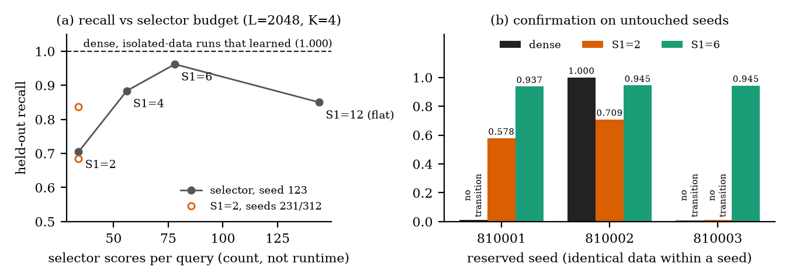

# Does a Cheap Block Selector Keep Recall?

Code, pre-registered protocols, run records and paper source for
**"Does a Cheap Block Selector Keep Recall? A Pre-Registered Budget Study on MQAR"**
(Anuj Dev Singh, Independent Researcher).

**Paper:** arXiv link coming soon. Build locally: `cd paper && latexmk -pdf main.tex`

## TL;DR

We train small models on multi-query associative recall (MQAR) at length L=2048 and vary S1, the number of
super-blocks a two-level sparse-attention block selector keeps per query, against dense attention trained on
identical data.

- **A larger budget helped.** On the pilot seed, held-out recall rose from 0.705 at S1=2 to 0.962 at S1=6, and
  S1=6 beat S1=2 on all four seeds where both were run.
- **No setting reached dense.** On the one reserved seed where dense attention learned, dense beat S1=6 by 0.055;
  the pre-registered near-dense bar was 0.02, so no budget met it.
- **Errors come from choosing the wrong blocks, not from failing to read them.** When the selector picked the
  block holding the key, recall was 0.978-1.000 across the 11 learned models.
- **Dense attention was unreliable on this recipe.** It learned the task on only 2 of 4 seeds within 60 epochs
  (when it did, it reached 1.000), while S1=6 learned on all four.



*Figure 1. Recall rises from S1=2 to S1=6, but no setting matches dense attention where dense learned
(L=2048, K=4, M5 profile).*

| Result (held-out recall, L=2048, K=4) | Value |
|---|---|
| Pilot seed 123: S1=2 / 4 / 6 / 12 (flat) | 0.705 / 0.884 / 0.962 / 0.850 |
| S1=6 on three untouched seeds | 0.937 / 0.945 / 0.945 |
| Dense − S1=6 on the one reserved seed where dense learned | 0.055 (pre-registered bar: 0.02) |
| Recall when the selector chose the key's block (11 learned models) | 0.978–1.000 |

Every run is reported, including runs that never learned.

## Terms

| Term | Meaning |
|---|---|
| S1 | Super-blocks kept per query. At L=2048 there are 12 super-blocks, so S1=12 is effectively flat block selection. |
| K | Fine blocks kept per query (4 throughout). |
| Block | 16 tokens. |
| M4 profile | float32 and the legacy data generator, which draws from the global random state. |
| M5 profile | TF32 and isolated, seeded data (a seed fixes the data exactly). Used for the main results; never pooled with M4. |
| Seed 123 | Pilot seed (231 and 312 are further pilot seeds). |
| Seeds 810001-810003 | Reserved confirmation seeds, not used before the M5 confirmation runs. |

## Paper section → files

| Paper section | Files |
|---|---|
| Sec. 3, budget | `experiments/m5_results/` (`runs/`, `followup/`) |
| Sec. 4, selection | `experiments/m5_results/selection_diagnostic/`, `audits/verify-routing-2026-10-01/` |
| Sec. 5, repairs | `experiments/m4_results/` |
| Sec. 6, dense | `experiments/m5_results/round2ef/` |
| Pre-registrations | `docs/protocol-*.md` |

## Layout

```
src/hier_nsa.py              hierarchical block selector (the model under test)
src/hier_telemetry.py        router telemetry helper
experiments/m4_routing_arms.py   training harness (zoology-based); m4_data.py: isolated, seeded MQAR data
experiments/diagnose_routing.py  selection-vs-reading diagnostic; modal_diagnose_m5.py runs it on Modal
experiments/m5_results/      M5-profile runs (main results): per-run manifest, metrics, result, train log
  selection_diagnostic/      replay of all 12 selector checkpoints (paper Section 4)
  followup/, round2ef/       S1=6 confirmation runs, dense float32 reruns
experiments/m4_results/      M4-profile runs (routing repairs, paper Section 5)
audits/verify-routing-2026-10-01/  M4-profile routing probes (appendix selection table, K probe)
docs/protocol-*.md           protocols, frozen before the runs they govern
paper/                       LaTeX source, figures and the scripts that regenerate them
```

## Reproduce

```bash
bash experiments/setup_cpu_env.sh          # pinned zoology (1ad20d1) + CPU venv, for tests and analysis
export ZOOLOGY_DIR=$PWD/zoology
.venv-cpu/bin/python experiments/test_hier_masks.py
python3 paper/figures/make_figures.py      # figures from the run records
python3 paper/make_tables.py               # appendix all-runs table
python3 experiments/m5_results/summarize.py
```

Training a model needs one GPU (we used an NVIDIA L40S) and the command recorded in that run's `manifest.json`.
`experiments/test_hier_arms.py` compares against a commit of the original development repository; outside it, that
check reports itself as skipped.

## Notes on this release

- This repository is a curated snapshot of a private research repository. Earlier exploratory experiments (paper
  Appendix "Earlier exploratory results") are not included.
- Cloud storage locations and machine identifiers in run records are replaced by placeholders such as
  `<checkpoint-bucket>`.
- Model checkpoints are not included; seeds, split hashes and code hashes in each manifest identify every run.

## Citation

```bibtex
@misc{singh2026cheapselector,
  title  = {Does a Cheap Block Selector Keep Recall? A Pre-Registered Budget Study on MQAR},
  author = {Singh, Anuj Dev},
  year   = {2026},
  note   = {arXiv preprint, forthcoming},
  url    = {https://github.com/eumnesia-labs/sparse-attention-recall}
}
```

See also [CITATION.cff](CITATION.cff).

## Contact

Questions and issues via [GitHub Issues](https://github.com/eumnesia-labs/sparse-attention-recall/issues).

## License

MIT. See [LICENSE](LICENSE).
