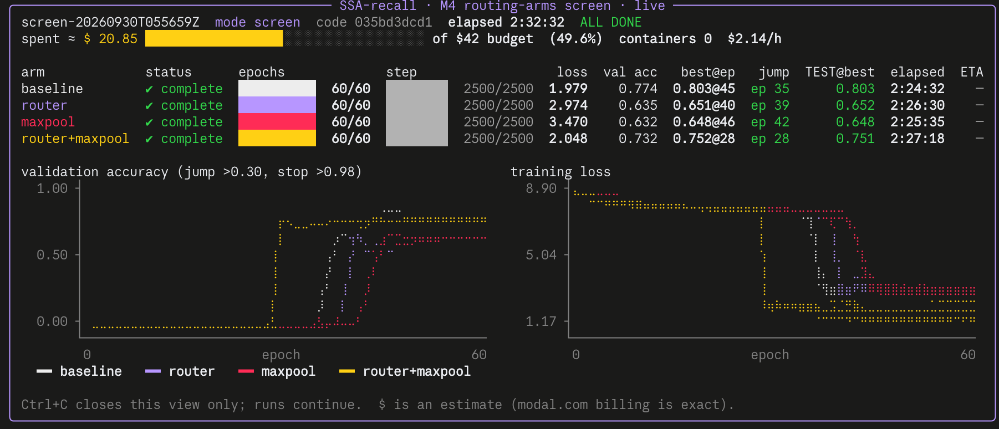
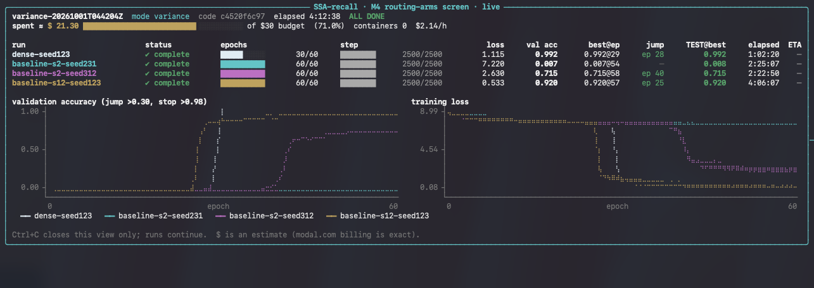

# M4 results — can the cheap S1=2 selector be made lossless? (screen, seed 123)

**Runs:** Modal L40S ×4 in parallel, 2026-09-30, `screen-20260930T055659Z`, code `035bd3d`
(clean tree). Protocol frozen before any result: [`docs/protocol-m4-routing-arms.md`](../../docs/protocol-m4-routing-arms.md).
Harness: `experiments/m4_routing_arms.py`; launcher: `experiments/modal_m4_arms.py`.

**Recipe:** M2c's `s2-k4` control, unchanged — L2048, 128 KV pairs, vocab 8192, d_model 128,
2 layers, lr 3.2e-4, wd 0.1, cosine over 60 epochs, micro-batch 8 × grad-accum 2, no clipping,
early stop at validation > 0.98 (not reached). S1=2 (34 selector pairs/query), K_SEL=4.

**Question:** M2c left S1=2 about 0.2 below dense at L2048. Two cheap causes were suspected:
(1) the level-1 super-block scores are used only for `topk`, so they get **no direct loss
gradient** (shared Q/K projections still learn through other branches);
(2) super-block summaries are **mean-pooled**, blurring the one key a query needs.
Each arm fixes one or both at the **same selector budget**:

| arm | change (opt-in flag in `src/hier_nsa.py`) |
|---|---|
| baseline | none (defaults byte-identical to `ba09be2`) |
| router | `router_gate=True`: log-sigmoid gate on selected super-blocks → router receives gradient; routing decisions unchanged |
| maxpool | `superblock_pool="max"`: super-block summary = max over its blocks |
| router+maxpool | both |

## Result

Primary metric: **held-out test accuracy** (2,000 sequences from a separate seed, never used for
training or selection) of the best-validation checkpoint. This is the repo's first untouched-test
number; earlier milestones report selected validation results.

| arm | **held-out test** | Δ vs baseline | best validation (epoch) | final-epoch test | jump > 0.30 | wall | ≈ cost |
|---|--:|--:|--:|--:|--:|--:|--:|
| **baseline** | **0.803** | — | 0.803 (45) | 0.776 | ep 35 | 2.41 h | $5.16 |
| router+maxpool | 0.751 | −0.052 | 0.752 (28) | 0.731 | ep 28 | 2.45 h | $5.25 |
| router | 0.652 | −0.151 | 0.651 (40) | 0.636 | ep 39 | 2.44 h | $5.23 |
| maxpool | 0.648 | −0.155 | 0.648 (46) | 0.633 | ep 42 | 2.43 h | $5.19 |

Validity: all four runs completed 60 epochs (`status: complete`, `time_capped: false`,
`protocol_conformant: true`); train / validation / held-out share 0 sequences; every arm generated
its data cold in its own container, so all four trained on **identical data from identical initial
weights** (paired comparison). Raw outputs: [`screen-20260930T055659Z.json`](screen-20260930T055659Z.json).

## Reading (per the pre-set decision rules)

- **No arm "recovers"** (rule 3: held-out ≥ baseline + 0.10). Router and max-pooling each scored
  ~0.15 **below** baseline; combined they learned fastest (jump at epoch 28) but settled lower.
- **These two attempted fixes failed the screen.** That does not rule out gradient-free routing
  or summary dilution as real limits — a remedy can fail even when its motivating mechanism
  matters — and it does not establish the budget as the cause. *(Corrected 2026-10-01; the first
  version said the budget was the more likely cause, which the data does not support.)*
- Independent review ([`audits/sol-2026-10-01/REPORT.md`](../../audits/sol-2026-10-01/REPORT.md),
  CPU reproductions re-run and matched): max-pooling is not a reliable proxy for the best member
  match with signed queries; the router gate reweights children of a still-incomplete placeholder
  super at early positions (2/3 → 1/2 in a small example); validity is inferred from the
  `NEG=-1e9` sentinel, which breaks at extreme scores (future leakage, a dropped valid branch).
  Whether such scores occurred in these runs is unknown — no score telemetry was recorded.
- Variance cannot be inferred from the older 0.007 / 0.726 / 0.759 S1=2 runs: they used different
  recipes and metrics. Seeds 231 / 312 (running 2026-10-01) are the first matched spread.
- **One seed is a screen, not evidence** (rule 1). Since no arm met the recovery bar, no
  confirmation seeds are planned for these arms.
- The baseline's 0.803 is not comparable to the mission bar (≈ dense − 0.02) until dense attention
  is run under this protocol (rule 4); the recorded dense 0.992 is a best-over-run validation value
  from the older protocol.

## Follow-up 2026-10-01 — dense, S1=2 seed spread, S1=12 (`variance-20261001T044204Z`)

Code `c4520f6` (clean), Modal L40S ×4, decision rules = protocol Amendment 2 (written before these
results). Analysis: `experiments/analyze_variance.py` →
[`../m4_verdicts/variance-20261001T044204Z-verdict.json`](../m4_verdicts/variance-20261001T044204Z-verdict.json).
Raw: [`variance-20261001T044204Z.json`](variance-20261001T044204Z.json).

| run | held-out test | final-epoch test | best val (epoch) | jump | epochs | wall | ≈ cost |
|---|--:|--:|--:|--:|--:|--:|--:|
| dense, seed 123 | **0.992** | 0.992 | 0.992 (29) | 28 | 30 (early stop) | 1.04 h | $2.22 |
| S1=12, seed 123 | **0.920** | 0.920 | 0.920 (57) | 25 | 60 | 4.10 h | $8.78 |
| S1=2, seed 312 | 0.715 | 0.715 | 0.715 (58) | 40 | 60 | 2.38 h | $5.10 |
| S1=2, seed 231 | 0.008 | 0.008 | 0.007 (54) | — | 60 | 2.42 h | $5.18 |

All complete, uncapped, zero split overlap, cold data. Seeds 231 / 312 use their own data and
held-out seeds; dense and S1=12 share seed 123's held-out split with the M4 screen.

**Verdict (rules fixed in advance):**
1. *Spread:* S1=2 at seeds 123 / 231 / 312 = 0.803 / 0.008 / 0.715 → R = 0.796 (band "comparable to
   the M4 deficits"), mean 0.509, median 0.715, sample SD 0.436, **1 non-transition of 3**.
2. *M4 reading:* the −0.15 / −0.15 / −0.05 fix deficits are one-seed paired observations amid large
   variability; not declared noise, not proof of harm.
3. *Budget:* S1=12 − S1=2 (seed 123) = **+0.117** → exploratory recovery. Neither hier point is
   near-dense (bar 0.972). Pre-set consequence: prioritise an S1=4/6 curve and independent
   confirmation.
4. *Mission:* no hier setting meets "no recall loss" here; even S1=12 (no parent pruning) at K=4 is
   ~0.07 below dense.

Caveats: dense not paired on training noise tokens; S1=12 = budget plus candidate coverage;
seed-123 results exploratory; three draws are not a stable variance estimate.

## Records and cost

- Two smoke runs (`smoke-*.json`, ~$0.11): the second projected 2.44 h/run from a warm epoch;
  actual 2.41–2.45 h.
- A first launch (`screen-20260930T044345Z.json`) was **cancelled at epoch ~13** when the laptop
  slept: `modal run --detach` keeps only the last triggered call alive. Incomplete under rule 5;
  never reported. Launches now deploy and spawn independent jobs (`--launch` / `--collect`).
- Total Modal spend for M4 ≈ $25.7 (screen ≈ $20.8).
- Follow-up 2026-10-01: smoke ~$0.4 (the client lost its connection mid-smoke; all four smoke runs
  completed and were read back from the live store), batch ≈ $21.3 (dashboard estimate).
