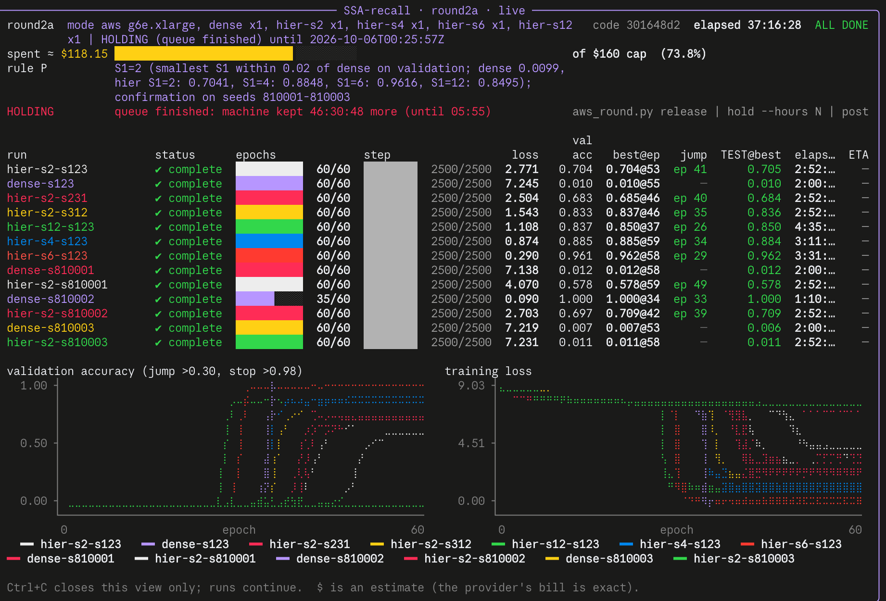

# M5: the S1 budget curve and confirmation under isolated data (AWS round 2a, 2026-10-02 → 10-04)

The pre-registered next batch after M4 ([draft](../../docs/protocol-m5-next-batch.md)), frozen as machine A of
[`docs/protocol-round2.md`](../../docs/protocol-round2.md) on 2026-10-02, before any round-2 data. Thirteen runs,
all complete. Tables are regenerated by [`summarize.py`](summarize.py) into [`summary.json`](summary.json).

## Setup

- **Task and recipe:** zoology MQAR at L2048 with 128 KV pairs, vocab 8192.
  - Model: d_model 128, 2 layers, 4 heads.
  - Optimiser: AdamW, lr 3.2e-4, weight decay 0.1, cosine schedule over 60 epochs.
  - Batch: micro-batch 8 × accumulation 2.
  - Early stop at validation > 0.98.
  - Splits: 20k train / 2k validation / 2k held-out.
  - **Primary metric:** held-out accuracy at the best-validation checkpoint.
- **New profile for M5:** TF32 matmuls and isolated data RNG (`m4_data.SeededMQARConfig`, cache
  `mqar-isolated-cpu-v1`).
  - With isolated data, a seed fixes the data exactly. Every same-seed dense/hier pair below trained and was
    scored on **identical splits**, verified by SHA-256 split hashes in the manifests (`identical_data` in
    `summary.json`).
  - Because the profile is new, these numbers are **not pooled** with M4's float32 / legacy-data results.
- **Hier settings:** baseline arm, K=4, sentinel masks, mean pooling, router gate off, observational router
  telemetry. Dense is MHA on the same recipe.
- **Machine:** one AWS g6e.xlarge (L40S), us-east-1a, `<ec2-instance>`. Runs went one at a time, since the
  smoke found concurrency slower.

## Results (held-out test accuracy at the best-validation checkpoint)

| run | seed | held-out | best val (epoch) | jump > 0.30 | epochs | hours |
|---|--:|--:|--:|--:|--:|--:|
| hier S1=2 | 123 | 0.705 | 0.704 (53) | ep 41 | 60 | 2.87 |
| dense | 123 | **0.010** | 0.010 (55) | never | 60 | 2.00 |
| hier S1=2 | 231 | 0.684 | 0.685 (46) | ep 40 | 60 | 2.87 |
| hier S1=2 | 312 | 0.836 | 0.837 (46) | ep 35 | 60 | 2.87 |
| hier S1=12 | 123 | 0.850 | 0.850 (37) | ep 26 | 60 | 4.59 |
| hier S1=4 | 123 | 0.884 | 0.885 (59) | ep 34 | 60 | 3.20 |
| hier S1=6 | 123 | **0.962** | 0.962 (58) | ep 29 | 60 | 3.53 |
| dense | 810001 | 0.012 | 0.012 (58) | never | 60 | 2.01 |
| hier S1=2 | 810001 | 0.578 | 0.578 (59) | ep 49 | 60 | 2.87 |
| dense | 810002 | **1.000** | 1.000 (34) | ep 33 | 35 (early stop) | 1.17 |
| hier S1=2 | 810002 | 0.709 | 0.709 (42) | ep 39 | 60 | 2.87 |
| dense | 810003 | 0.006 | 0.007 (53) | never | 60 | 2.01 |
| hier S1=2 | 810003 | 0.011 | 0.011 (58) | never | 60 | 2.88 |

Runs are listed in queue order. The first seven are stage P (pilot); the last six are stage F (confirmation on
the reserved seeds 810001-3).

### Budget curve, seed 123

| S1 | selector pairs/query | held-out |
|--:|--:|--:|
| 2 | 34 | 0.705 |
| 4 | 56 | 0.884 |
| 6 | 78 | **0.962** |
| 12 | 144 | 0.850 |

### S1=2 spread

- **Pilot seeds 123/231/312:** 0.705 / 0.684 / 0.836.
  - Range R 0.152, mean 0.742, median 0.705, sample SD 0.082.
  - 0 non-transitions.
- **All six draws** (adding 810001-3): mean 0.587, median 0.695, SD 0.294, 1 non-transition (810003).

### Confirmation pairs, all released including non-transitions (identical data within each pair)

| seed | dense | hier S1=2 | dense − hier | note |
|--:|--:|--:|--:|---|
| 810001 | 0.012 | 0.578 | −0.566 | dense never transitioned |
| 810002 | **1.000** | **0.709** | **+0.291** | the only pair where both transitioned |
| 810003 | 0.006 | 0.011 | −0.005 | neither transitioned |

Seed 123 (pilot) as a fourth pair: dense 0.010, S1=2 0.705, −0.695 (dense never transitioned).

## Rule P (pre-registered)

**The rule:** choose the smallest S1 whose seed-123 best validation is ≥ dense's best validation − 0.02;
otherwise choose the highest validation.

**What happened:** dense@123 never transitioned (best validation 0.0099). The threshold was therefore negative,
every S1 qualified, and **rule P chose S1=2 vacuously**. It was applied as written, with no deviation.
- The rule's hold for a "failed" run referred to a run that ends in failure, not to a reference that completes
  without learning. The rule did not anticipate the second case.
- Had dense transitioned near its usual ceiling (≈ 0.99, threshold ≈ 0.97), no S1 would have qualified and the
  fallback would have chosen **S1=6**.
- The S1=2 confirmation is still the operating point the mission cares about (the cheapest pruning budget). It is
  not the best-recall point.

## Reading

- **The one clean comparison:** at the only seed where both transitioned (810002), **S1=2 loses 0.291 held-out
  recall** to dense. The sign and rough size match M2c and M4, where S1=2 sat about 0.2-0.3 below dense under the
  older protocols.
- **Recall rises with selector budget from S1=2 to S1=6 at seed 123:** 0.705 → 0.884 → 0.962.
  - S1=12 (0.850) is below S1=6 at this seed.
  - At L2048 the tree has 12 super-blocks, so S1=12 selects every super-block (no parent pruning). It differs
    from S1=6 in coverage as well as budget.
  - One seed cannot order S1=6 and S1=12. S1=6 is not shown to be near-dense, because dense did not transition
    at seed 123.
- **S1=2 transitioned in 5 of 6 draws** (0.578-0.836 when it did). In M4, under the legacy profile, it
  transitioned in 2 of 3.
- **Dense transitioned in only 1 of 4 draws under this profile.** In M4, under float32 and legacy data, dense@123
  transitioned at epoch 28 and reached 0.992. Under the M5 profile the dense baseline is unreliable within 60
  epochs, more so than hier.
  - This is an optimisation-reliability observation, not a recall-capacity claim: when dense transitioned it
    reached 1.000.
  - The cause is **not identified**. Candidates are TF32 numerics, the isolated data generator, or ordinary
    seed-to-seed variance of MQAR's late phase transition. The profile changed numerics and data together, so
    the data cannot separate them.

## What this does not establish

- A reliable dense − sparse gap: one valid pair is not an estimate.
- That S1=6 is near-dense: one seed, with no transitioned dense at that seed.
- Why dense fails to transition under this profile.
- Anything about position-free retrieval. Zoology MQAR places every key in the first 256 tokens, so a positional
  shortcut is available (protocol caveat).
- Runtime or FLOPs: pairs/query is a selector-count proxy.

## Caveats

- **Non-transition means "did not cross 0.30 within 60 epochs".** MQAR learns through a late phase transition, so
  a longer ceiling could change any never-transitioned run.
- **The manifests say `protocol_conformant=False`, as expected:** the precision override is recorded as
  `overrides={'precision': 'tf32'}`, under profile `m5-isolated-data-draft-v1`.
- **Seed 123 is exploratory:** its test split has informed design since M4. Seeds 810001-3 were reserved on
  2026-10-01 and untouched before this round.
- **One machine type, one run at a time, one recipe:** no learning-rate sweep. The M1-M3 recipe fact
  "lr 3.2e-4 is the only converging LR at L512+" was established under float32.

## Next, before the write-up (needs owner approval)

1. **Dense reliability check** (two runs, about 6 h, about $12): dense@123 in float32 on isolated data, and
   dense@123 in TF32 on legacy data. Whichever run learns identifies the cause, and fixes the baseline the paper
   compares against.
2. **Optional: S1=6 confirmation on 810001-3** (three runs, about $20). This tests whether the best budget point
   holds beyond one seed.

## Cost

- **Machine A for round 2a:** 18:04 IST 2 Oct (spec reload) to its release at 10:07 IST 4 Oct, about 40 h at
  $1.877/h, about $75. This includes about 4 h idle hold after the queue finished at 05:55.
- **Rounds 1 + 1b + 2 together:** meter total **$123.21** of the $160 cap, covered by AWS credits.

## Provenance

- **Code:** the development branch commit `301648d2f932e2dd86dcc98a3c4b8a337822140b` ([`round2a-code.json`](round2a-code.json)).
  - Runner: `experiments/round_runner.py`. Plan: `experiments/round2a_plan.py`. Per-run script:
    `experiments/m4_routing_arms.py`. Launcher: `experiments/aws_round.py`.
  - The tarball the machine ran is `s3://<checkpoint-bucket>/round2a/code/301648d2f932e2dd86dcc98a3c4b8a337822140b.tar.gz`.
- **Per run, under `runs/<label>/`:**
  - `result.json`, `manifest.json` (seeds, split hashes, environment, identity);
  - `metrics.jsonl` (per epoch, including router telemetry);
  - `heldout_best_per_sequence.json`, `progress.json`;
  - `train.log.gz` (full stdout, gzip);
  - `run_folder.txt` (the original run folder name).
  - Checkpoints (`ckpt.pt`) stay in `s3://<checkpoint-bucket>/round2a/runs/`.
- **Runner records:**
  - `round2a-state.json`: queue, rule P decision, holds.
  - `round2a-smoke.json`: speed test. dense 0.0458, S1=2 0.0668, S1=4 0.0744, S1=6 0.0820 and S1=12 0.1068 s/step;
    the CUDA equivalence check passed.
  - `round2a-boot-<ec2-instance>.json`: meter record.
- **Dashboard:** [`m5_dashboard.png`](m5_dashboard.png), the live dashboard captured by the owner after the queue
  finished. Its $118.15 is the meter at capture time; the final meter is $123.21.

