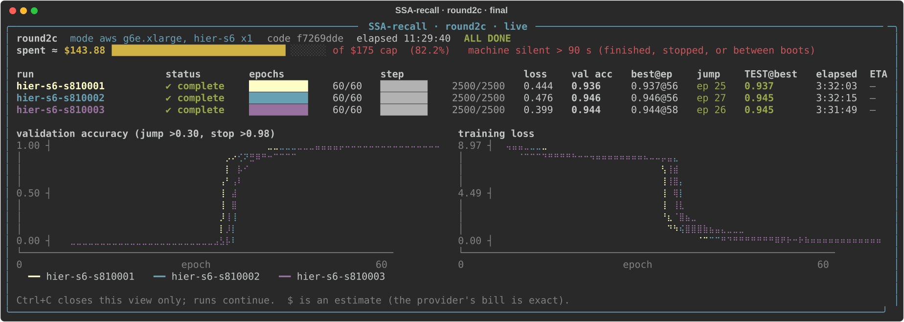
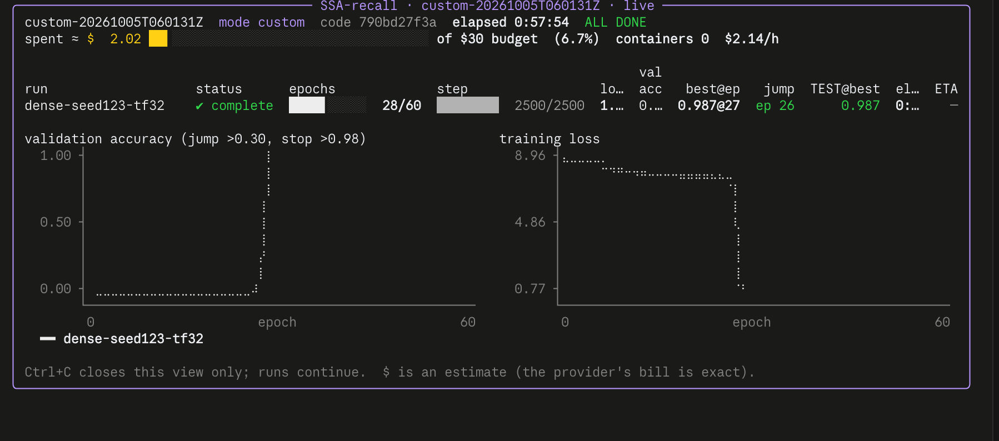
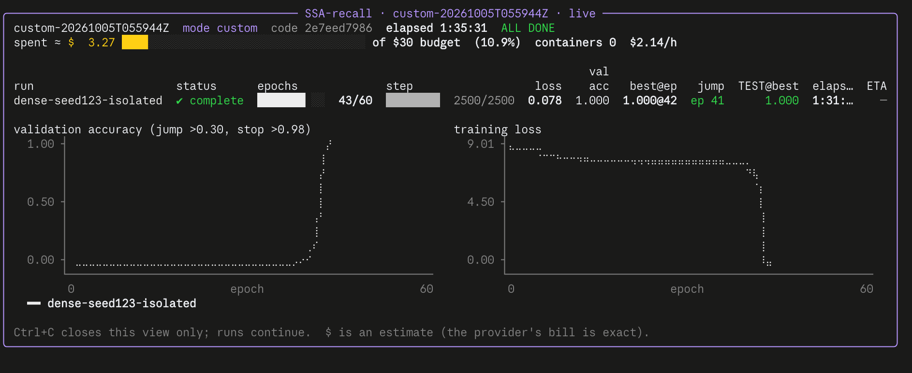

# M5 follow-ups: S1=6 confirmation and dense check (2026-10-05)

Pre-registered in [`docs/protocol-round2cd.md`](../../../docs/protocol-round2cd.md), frozen before any data. Same
recipe as M5 (L2048 MQAR, 60 epochs, early stop at validation > 0.98, held-out accuracy at the best-validation
checkpoint). Five runs, all complete. Tables are regenerated by [`summarize_followup.py`](summarize_followup.py)
into [`summary_followup.json`](summary_followup.json).

| run | held-out | best val (epoch) | jump > 0.30 | epochs | hours | where |
|---|--:|--:|--:|--:|--:|---|
| hier S1=6 @810001 | 0.937 | 0.937 (56) | ep 25 | 60 | 3.53 | AWS, TF32, isolated |
| hier S1=6 @810002 | 0.945 | 0.946 (56) | ep 27 | 60 | 3.54 | AWS, TF32, isolated |
| hier S1=6 @810003 | 0.945 | 0.944 (58) | ep 26 | 60 | 3.53 | AWS, TF32, isolated |
| dense @123, TF32, legacy data | 0.987 | 0.987 (27) | ep 26 | 28 (early stop) | 0.94 | Modal |
| dense @123, float32, isolated data | **1.000** | 1.000 (42) | ep 41 | 43 (early stop) | 1.52 | Modal |

## S1=6 confirmation (round 2c)

- **S1=6 transitioned on all 3 reserved seeds:** 0.937 / 0.945 / 0.945.
  - Mean 0.942, median 0.945, minimum 0.937, sample SD 0.005.
  - The jumps came at epochs 25-27.
- **Paired with M5 on identical data** (split hashes equal for all three runs on each seed):

| seed | S1=6 | S1=2 (M5) | dense (M5) | S1=6 − S1=2 | dense − S1=6 |
|--:|--:|--:|--:|--:|--:|
| 810001 | 0.937 | 0.578 | 0.012 (no transition) | +0.359 | n/a: dense did not transition |
| 810002 | 0.945 | 0.709 | **1.000** | +0.236 | **+0.055** |
| 810003 | 0.945 | 0.011 (no transition) | 0.006 (no transition) | +0.933 | n/a: dense did not transition |

- **Pre-set reading:** "near-dense at 810002" required S1=6 ≥ 0.98 (dense − 0.02). With 0.945, **S1=6 is not
  near-dense**: it is 0.055 below dense on the one seed where dense transitioned.
- **S1=6 against S1=2:** S1=6 is far above S1=2 on every seed (+0.24 to +0.93). It is also far more reliable:
  3/3 transitions against S1=2's 5/6, including 810003, where S1=2 and dense both failed.
- **Selection caveat:** S1=6 was chosen after M5's seed-123 pilot (the best validation there). This is a confirmation
  of a selected point. At 78 selector pairs/query, against 34 for S1=2, it is also a more expensive operating point.

## Dense check, seed 123

| profile | held-out | jump | source |
|---|--:|--:|---|
| float32 + legacy data | 0.992 | ep 28 | M4 follow-up (Modal, older code; context only) |
| TF32 + isolated data | 0.010 | never | M5 (AWS) |
| **TF32 + legacy data** | **0.987** | ep 26 | this round |
| **float32 + isolated data** | **1.000** | ep 41 | this round, identical data to M5's dense@123 (split hashes) |

- **Pre-set reading (row 3, "both transition"):** neither TF32 nor the isolated data generator alone explains
  M5's dense non-transition at seed 123.
- **Dense learns under TF32**, at almost the same epoch as M4's float32 run (26 vs 28).
- **On the isolated data, dense's transition came late** (epoch 41) even in float32. Combined with TF32 (M5), it did
  not come within 60 epochs.
- **The most likely explanation is that dense's transition timing varies a lot with the data draw and the
  numerics**, and the 60-epoch ceiling cuts off late transitions. This is consistent with M5, where dense
  transitioned in 1 of 4 runs and reached 1.000 when it did.
- **One seed per cell:** this suggests the explanation; it does not establish it.

## What changes for the write-up

- **The S1=2 vs dense gap holds where dense transitions:** −0.291 at 810002. **S1=6 cuts it to −0.055**
  (810002) and transitions reliably.
- **The dense baseline needs a protocol that transitions reliably.** Without that, most dense-vs-hier pairs on the
  isolated data are not valid comparisons; today only 810002 is. Candidates: float32 for dense, and/or a longer
  epoch ceiling. Either is a stated change to the recipe.
- **Owner decision, before writing:** dense on seeds 810001 and 810003 in float32. That gives every confirmation
  seed a valid dense pair.

## Deviation from the pre-registration

- **The dense check ran on Modal, not AWS.** The owner decided this on 2026-10-05 around 11:30 IST, before any
  dense-check data. The reason: AWS had no L40S free in us-west-2 or ap-south-1 for about 2 h, and us-east-1's quota
  was taken by round 2c.
- **Same GPU type (L40S) and the same run code:** `m4_routing_arms.py`, `m4_data.py` and `src/` are identical at
  f7269dd, 2e7eed7 and 790bd27, as `git diff` confirms. Each Modal container's data cache was container-local and
  cold, as the protocol requires for legacy data.
- **Commits:** the float32 run used 2e7eed7, and the TF32 run used 790bd27, which adds the launcher's `--precision`
  option.

## Caveats

- **Software differs slightly between machines:**
  - round 2a: torch 2.14.0+cu130, Python 3.13.15;
  - round 2c: torch 2.14.1+cu130, Python 3.13.16 (DLAMI 20261003);
  - Modal: torch 2.14.0+cu130, Python 3.11.12.
- **Every hier run is TF32. The only working dense pair (810002) is TF32 too.** The float32 dense run is a
  diagnostic, not a pair for any hier run.
- **Zoology MQAR keeps keys in the first 256 tokens** (positional shortcut possible). Selector pairs/query is a
  count proxy, not runtime.

## Cost

- **Round 2c (AWS):** 09:14 to about 20:15 IST, about 11 h at $1.877/h, about $21. The AWS meter total for all
  rounds is now **$143.88** of the $175 cap.
- **Dense check (Modal):** $3.26 + $2.01 = **$5.27**, inside the month's free credit.

## Provenance

- `runs/<label>/`: `result.json`, `manifest.json` (seeds, split hashes, environment, code hashes),
  `metrics.jsonl`, `heldout_best_per_sequence.json`, `progress.json`, `train.log.gz`, `run_folder.txt`.
- **Checkpoints:** `s3://<checkpoint-bucket>/round2c/runs/` (AWS) and Modal volume `ssa-recall-m4-runs`,
  `runs/m4-L2048-dense-seed123__20261005T055956Z` and `__20261005T060142Z`.
- **Round 2c records:** `round2c-state.json`, `round2c-smoke.json` (S1=6 0.0828 s/step; CUDA equivalence passed),
  `round2c-boot-*.json`, `round2c-code.json` (f7269dd), `round2c-ami.json`.
- **Modal launch records:** `modal/custom-20261005T055944Z*` (float32) and `modal/custom-20261005T060131Z*` (TF32).
- **Dashboards:**
  - `s1_6_confirmation_dashboard.svg`: final state, exported from the round 2c store;
  - `dense_check_tf32_legacy_dashboard.png` and `dense_check_fp32_isolated_dashboard.png`: captured by the owner.

