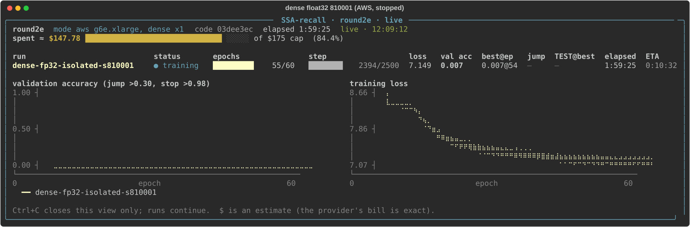
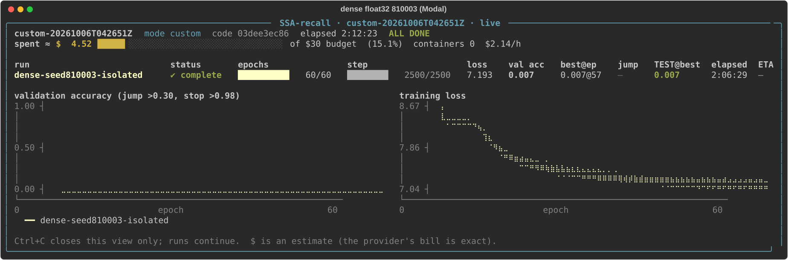

# Dense in float32 on confirmation seeds 810001 and 810003 (rounds 2e/2f, 2026-10-06)

Pre-registered in [`docs/protocol-round2ef.md`](../../../docs/protocol-round2ef.md) (ca7582d) with amendment 1
(81d1112 / 4131158: seed 810003 on Modal), both before any data. M5's recipe and data on each seed, float32 instead of
TF32. Code: the development branch 03dee3e for both runs. Tables are regenerated by
[`summarize_round2ef.py`](summarize_round2ef.py) into [`summary_round2ef.json`](summary_round2ef.json).

| run | where | status | epochs | best val (epoch) | jump > 0.30 | held-out | last validation loss |
|---|---|---|--:|--:|--:|--:|--:|
| dense fp32 @810001 | AWS g6e.xlarge, us-east-1c | **stopped by the owner, not complete** | 55 of 60 | 0.0068 (54) | never | — | 8.119 |
| dense fp32 @810003 | Modal L40S | complete | 60 | 0.0071 (57) | never | **0.0069** | 8.130 |

**Neither run transitioned.** Both stayed at chance-adjacent validation accuracy (0.006-0.007) while training loss
fell slowly (to about 7.2, live dashboards) and validation loss crept up over the last epochs: the same pattern as M5's failed dense runs.

## Paired with every earlier run on the same seed (identical splits, verified by hashes)

| seed | dense TF32 (M5) | **dense float32 (here)** | hier S1=2 (M5) | hier S1=6 (round 2c) | valid dense pair? |
|--:|--:|--:|--:|--:|---|
| 810001 | 0.012 (never) | **never** (best val 0.0068 at 55/60, stopped) | 0.578 | **0.937** | no |
| 810002 | **1.000** | — | 0.709 | **0.945** | yes (TF32) |
| 810003 | 0.006 (never) | **0.0069 (never)** | 0.011 (never) | **0.945** | no |

Split hashes of both new runs equal those of M5's dense and S1=2 runs and round 2c's S1=6 run on the same seed
(`identical_data_with_m5_dense_s1_2_s1_6` in the summary).

## Transitions on the isolated data, all runs

| model | transitioned | runs |
|---|--:|---|
| dense, TF32 | 1/4 | M5: 123, 810001, **810002**, 810003 |
| dense, float32 | 1/3 | **123** (dense check), 810001 (stopped at 55), 810003 |
| **dense, all** | **2/7** | |
| hier S1=6 | **4/4** | 123, 810001, 810002, 810003 |
| hier S1=2 | 5/6 | 123, 231, 312, 810001, 810002 (not 810003) |

## Pre-set reading

- **Each run is a non-transition** and is reported as such. Seeds 810001 and 810003 keep **no valid dense pair**; only
  810002 does (dense 1.000 vs S1=6 0.945, −0.055; vs S1=2 0.709, −0.291).
- No rerun with a longer epoch ceiling or other changes is made without a new pre-registration.

## What this adds to the write-up

- **Dense attention's reliability under this recipe is now a finding, not an anomaly.** On the isolated data, dense
  transitioned within 60 epochs in 2 of 7 runs, in both numerics. The hierarchical selector at S1=6 transitioned in
  4 of 4 on the same data, and S1=2 in 5 of 6.
- **On seeds 810001 and 810003, the sparse model learned (S1=6: 0.937, 0.945) where full attention, on identical
  data with the same recipe, did not** (in TF32 or float32).
- **This is about training reliability within 60 epochs, not recall capacity.** When dense transitioned it reached
  1.000 (810002) and 1.000 (123, float32). Why the selector trains more reliably is not tested here; candidate
  explanations (the sliding-window branch or block selection acting as an inductive bias, dense needing more epochs
  or a different learning rate at this length) are hypotheses only.
- **Consequence:** the paper can quote one valid dense-vs-hier gap (810002). Every other comparison is "hier learned,
  dense did not within 60 epochs", reported with the per-seed table above.

## Predictions recorded before the runs

| | Jev (two orders) | Claude | outcome |
|---|--:|--:|---|
| dense transitions on both seeds | 0.40 / 0.41 | 0.50 | no |
| dense transitions on at least one | 0.57 / 0.55 | 0.85 | **no** |

Jev's forecast was closer; Claude's 0.85 was overconfident.

## Deviation from the pre-registration

- **The owner stopped the AWS run (810001) at 12:07:31 IST, after 55 of 60 epochs** ("I do not think they learn, stop
  both and release the GPU"). The pre-registration said neither run would be interrupted.
- At the stop it had validation accuracy 0.0068, validation loss rising (8.112 → 8.119 over its last 6 epochs), and the
  cosine learning-rate schedule close to its end.
- It is reported as **stopped, not complete**: there is no held-out evaluation, and the best-validation checkpoint was
  not saved separately (the epoch-55 checkpoint is in `s3://<checkpoint-bucket>/round2e/runs/`). A
  transition in the last 5 epochs cannot be ruled out formally; nothing in its trajectory suggested one.
- The Modal run (810003) had completed all 60 epochs (about 12:04 IST) before the stop instruction.

## Caveats

- **Two platforms:** AWS (round 2e) and Modal (amendment 1). Same GPU type (L40S), same commit and run code, identical
  data, TF32 off in both manifests. Software differs: AWS torch 2.14.1+cu130 / Python 3.13.16, Modal torch
  2.14.0+cu130 / Python 3.11.12.
- **Mixed numerics across the comparison:** every hier run is TF32; the dense runs here are float32; M5's dense is
  TF32.
- **Non-transition means "not within 60 epochs"** (55 for the stopped run). MQAR learns through a late phase
  transition; a longer ceiling could change any of these.
- One run per seed and numerics: transition rates over 3-7 runs are counts, not estimated probabilities.

## Cost

- **AWS round 2e:** 2.07 h machine time (launch 10:02:56 IST, terminated 12:07:31 IST) at $1.877/h, about $3.89. The AWS
  meter total for all rounds is **$147.76** of the $175 cap.
- **Modal (810003):** 2.11 h, about $4.51 (estimate; the provider's bill is exact). This went slightly past October's
  free credit.

## Provenance

- `runs/dense-fp32-isolated-s810001/`: `manifest.json`, `metrics.jsonl`, `progress.json`, `train.log.gz`,
  `run_folder.txt` (no `result.json`: stopped before completion).
- `runs/dense-fp32-isolated-s810003/`: `result.json`, `manifest.json`, `metrics.jsonl`,
  `heldout_best_per_sequence.json`, `progress.json`, `train.log.gz`, `run_folder.txt`.
- Round 2e records: `round2e-state.json` (the job shows `running`: the machine was terminated mid-run),
  `round2e-smoke.json` (dense float32 0.0486 s/step), `round2e-boot-<ec2-instance>.json`, `round2e-code.json`
  (03dee3e), `round2e-ami.json`.
- Modal records: `modal/custom-20261006T042651Z-calls.json` (launch), `modal/custom-20261006T042651Z.json` (collect).
  Weights: Modal volume `ssa-recall-m4-runs`, `runs/m4-L2048-dense-seed810003__20261006T042701Z`.
- Dashboards (final state, exported from the live records): `dense_fp32_s810001_aws_dashboard.svg` (state at the stop)
  and `dense_fp32_s810003_modal_dashboard.svg`.

